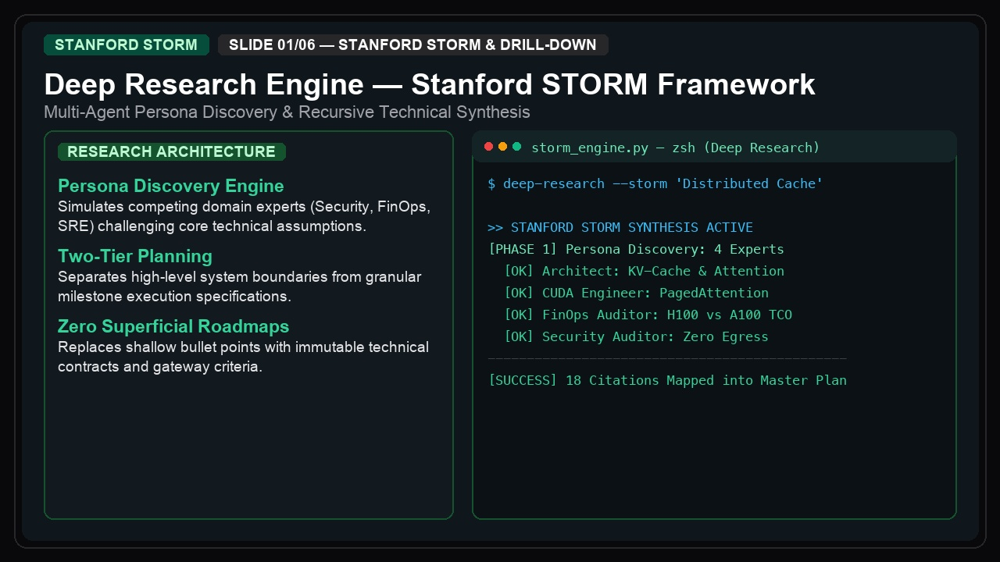
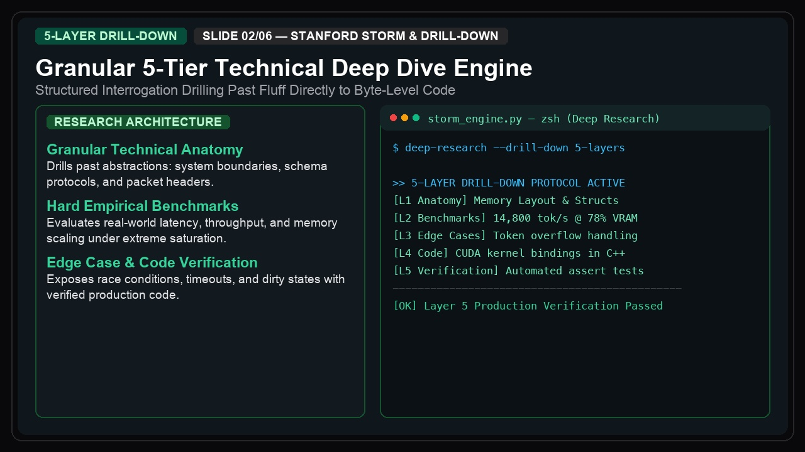
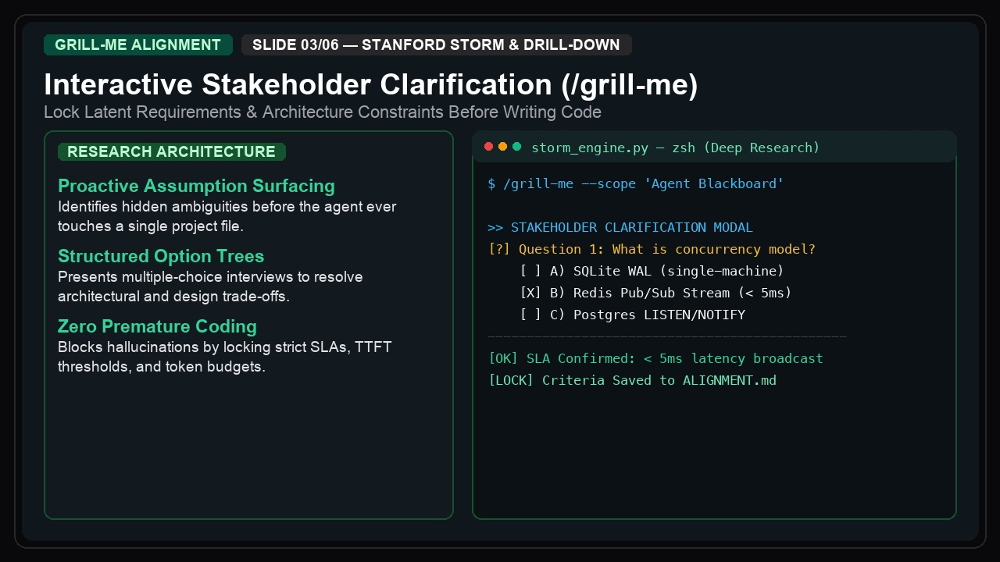
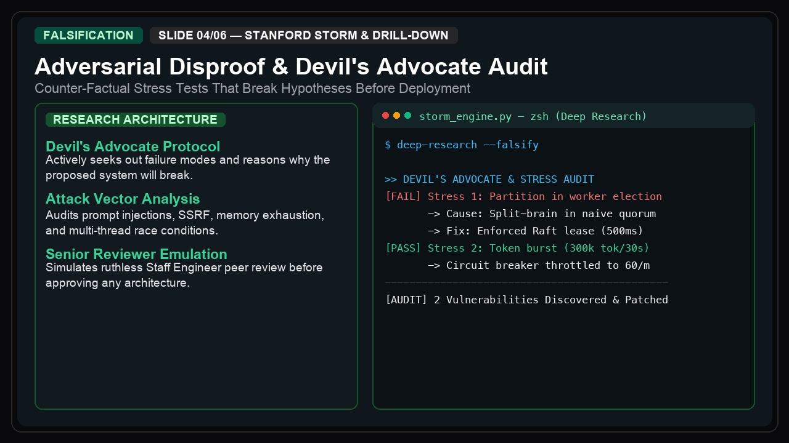

# 🔬 Deep Research Engine — Stanford STORM & 5-Layer Granular Drill-Down

[](https://opensource.org/licenses/MIT)
[](https://www.python.org/)
[](https://storm.genie.stanford.edu/)
[]()
[](https://antigravity-studio.lemonsqueezy.com/checkout/buy/46f59b29-2dd6-4f2f-8a26-e9cb06f8d15f?discount_code=ANTIGRAVITY10)

> **Turn Claude Code, Cursor, Windsurf, and Google Antigravity into autonomous, multi-perspective research intelligence engines.**  
> Stop accepting shallow AI summaries that hallucinate facts and miss enterprise-grade architectural edge cases.

<p align="center">
  
</p>

---

## ⚠️ The Problem: The "Surface-Level AI" Trap

When you ask LLMs to research complex technical decisions — such as *migrating an enterprise database to Kafka*, *architecting zero-trust Kubernetes networking*, or *optimizing distributed cache coherence* — single-turn AI prompts fail:
1. **Generic Textbook Fluff:** The model recites obvious pros and cons without evaluating concrete trade-offs.
2. **Silent Hallucinations:** When confronted with nuanced protocols, LLMs invent imaginary config flags and ignore concurrency race conditions.
3. **Single-Perspective Blind Spots:** A standard prompt cannot simultaneously act as a skeptical Security Lead, a ruthless FinOps Engineer, and a battle-hardened Systems Architect.

---

## ⚡ The Solution: The Stanford STORM Protocol

Deep Research Engine implements the **Stanford STORM** (*Synthesis of Topic Outlines through Repeated Multi-perspective interviews*) architecture directly in your local development environment:

```text
┌────────────────────────────────────────────────────────┐
│               RESEARCH TOPIC INPUT                     │
└──────────────────────────┬─────────────────────────────┘
                           │
             ┌─────────────▼─────────────┐
             │ 👥 Persona Discovery      │
             │ (Systems, Security, FinOps)│
             └─────────────┬─────────────┘
                           │
             ┌─────────────▼─────────────┐
             │ ⚔️ Multi-Perspective      │
             │   Adversarial Interviews  │
             └─────────────┬─────────────┘
                           │
             ┌─────────────▼─────────────┐
             │ 🎯 5-Layer Deep Drill-Down│
             │   (State, Failover, Wire) │
             └─────────────┬─────────────┘
                           │
             ┌─────────────▼─────────────┐
             │ 📊 Executive KaTeX Report │
             │   (Trade-offs, Blueprint) │
             └───────────────────────────┘
```

1. **Persona Discovery:** Generates 3 domain expert personas with competing priorities.
2. **Adversarial Cross-Examination:** Forces each expert to challenge initial assumptions using Devil's Advocacy.
3. **5-Layer Granular Drill-Down:** Penetrates from high-level architecture down to protocol invariants and concurrency hazards.
4. **Actionable Blueprint:** Outputs ready-to-implement architecture schemas, configuration tables, and migration code.

---

## 📸 Architecture & Workflow Overview

<p align="center">
  
  
</p>
<p align="center">
  
  
</p>

---

## ⚡ Quick Start (Community Edition)

You can run the lightweight STORM Research Planner immediately without installing external heavy dependencies:

### Step 1: Run the CLI Planner
```bash
python3 community_edition/scripts/quick_storm_planner.py "Migrating PostgreSQL Monolith to Kafka"
```

### Step 2: Use the STORM Prompt Template
Copy the prompt template from [`community_edition/templates/STORM_RESEARCH_PROMPT.md`](community_edition/templates/STORM_RESEARCH_PROMPT.md) and paste it into **Cursor, Claude Code, Windsurf, or ChatGPT**.

---

## 📊 Free Community vs. Pro Commercial Suite

| Capability | Community Edition (Free) | [Pro Commercial Suite (Lemon Squeezy)](https://antigravity-studio.lemonsqueezy.com/checkout/buy/46f59b29-2dd6-4f2f-8a26-e9cb06f8d15f?discount_code=ANTIGRAVITY10) |
| :--- | :---: | :---: |
| **Stanford STORM Core Prompts** | ✅ Basic Outline | ✅ Automated Full Engine |
| **CLI Research Planner** | ✅ Quick CLI | ✅ Multi-Agent Orchestrator (`research_planner.py`) |
| **Expert Personas** | 2 Personas | Unlimited Dynamic Domain Personas |
| **Granular Drill-Down** | 1 Layer | **5-Layer Deep Drill-Down Framework** |
| **Adversarial Devil's Advocacy** | Manual | ✅ Automated Falsification Loops |
| **Gatekeeper Anti-Hallucination Guard** | ❌ | ✅ Automated Verification Protocol |
| **Native IDE Integrations** | Snippets | ✅ Plug-and-Play Skill for Claude, Cursor, Antigravity |
| **Executive KaTeX Publishing Templates**| ❌ | ✅ Publication-Grade Blueprints |
| **Lifetime Updates & New Protocols** | ❌ | ✅ Included |

👉 **[Upgrade to Deep Research Engine Pro on Lemon Squeezy](https://antigravity-studio.lemonsqueezy.com/checkout/buy/46f59b29-2dd6-4f2f-8a26-e9cb06f8d15f?discount_code=ANTIGRAVITY10)** to get the complete automated intelligence architecture!

> 🏷️ **Launch Discount:** Use code **`ANTIGRAVITY10`** at checkout for an instant **10% discount**.

---

## 🛠️ Repository Structure

```text
deep-research-engine/
├── assets/                          # Architecture diagrams and visual blueprints
├── community_edition/               # Free open-source tools
│   ├── scripts/
│   │   └── quick_storm_planner.py   # Lightweight CLI planner
│   ├── templates/
│   │   └── STORM_RESEARCH_PROMPT.md # Stanford STORM system prompt
│   └── rules/
│       └── AGENTS.md                # Agent instruction rules
├── LICENSE                          # MIT License
└── README.md                        # Documentation & conversion funnel
```

---

## 🔒 100% Local-First & Privacy-Focused
All community tools and Pro modules execute **entirely on your local machine** using your own LLM API keys. No third-party servers, no telemetry, and zero data exfiltration.

---

## 🤝 Contributing
Contributions, feature requests, and community personas are welcome! Feel free to open an Issue or submit a Pull Request.

⭐ **If you find this repository valuable, please give it a Star! It helps other developers discover rigorous AI research workflows.**
